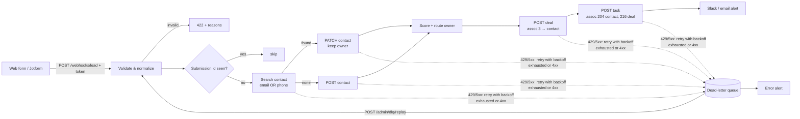
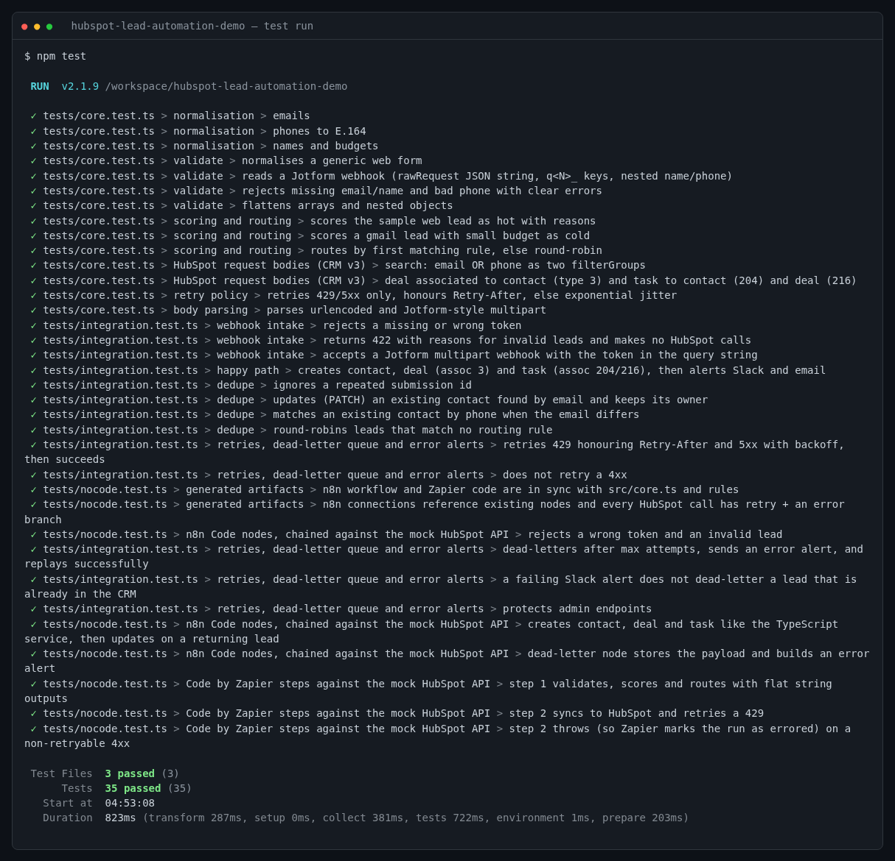
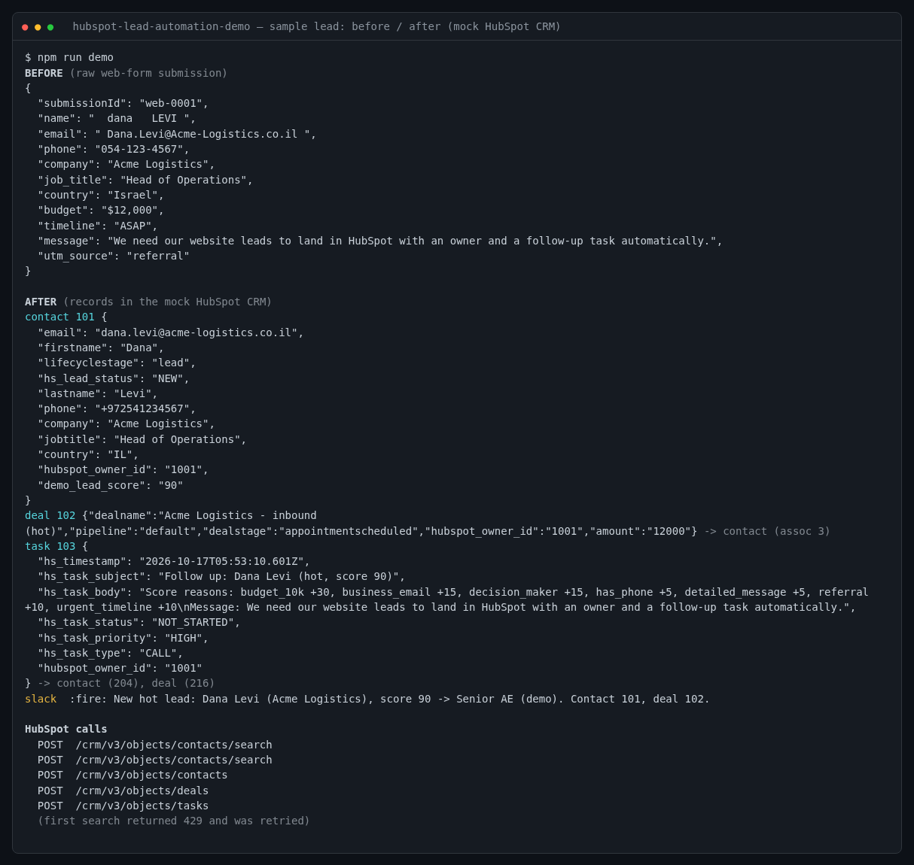

# HubSpot Lead Automation Demo: web form / Jotform → HubSpot, three ways

[](https://github.com/lrm22221-afk/hubspot-lead-automation-demo/actions/workflows/ci.yml)


> **Demo on mocks, not a client deployment.** Tests and CI run against a local mock of the HubSpot CRM v3 API and a mock
> Slack webhook, and need no HubSpot account. The service can run live with a private-app token, but **no live run is
> part of this repo**. Owner ids and the sample leads are made up.

One lead-intake flow, implemented three times so it fits whatever stack a client already uses:

1. **TypeScript service** (`src/`): full feature set, with tests.
2. **n8n workflow** (`n8n/`): importable JSON; its Code nodes are tested in CI.
3. **Zapier** (`zapier/`): two *Code by Zapier* steps plus a step-by-step Zap spec, **untested on live Zapier**.
   A Make blueprint is not included.

All three share the same validation, scoring, routing and HubSpot request-building code (`src/core.ts`), bundled into the
n8n and Zapier code by `npm run build:nocode`. CI fails if the bundled copies are out of date.

## The flow



## Features

- **Intake:** JSON, URL-encoded or multipart; Jotform's `rawRequest` JSON with `q<N>_` keys and nested name/phone fields;
  a shared-secret token in the `X-Webhook-Token` header or `?token=` (form tools can't sign requests).
- **Validation and normalization:** lower-cased email; names in title case; phone in E.164, using the lead's country calling code when known; country names to ISO codes; budgets such as `$12,000` or `2k` parsed to numbers; flags free email domains (gmail etc.). Invalid leads get a 422 with reasons and never reach HubSpot.
- **Dedupe:** by form submission id, then a HubSpot search for email **or** phone. A phone-only match doesn't overwrite the existing primary email. Returning contacts keep their owner and lifecycle stage.
- **Lead scoring:** rule-based and editable in `rules/rules.json`; reasons are written into the task body. Tiers: hot / warm / cold.
- **Owner routing:** the first matching rule wins (e.g. budget ≥ 10k → senior AE, country IL → IL rep), otherwise round-robin.
- **Deal and task:** a deal in the configured pipeline/stage, associated with the contact. A task due in 1h / 24h / 72h by tier, with priority and type, associated with the contact and the deal.
- **Alerts:** Slack incoming webhook plus an optional JSON email relay. If an alert fails, the lead isn't dead-lettered, since it's already in the CRM.
- **Reliability:** retries on 429 (honouring `Retry-After`), on 5xx and on network errors, with exponential backoff and full jitter. 4xx errors fail fast. After the last attempt the payload goes to a JSONL dead-letter queue with the failing step, and an error alert is sent. `POST /admin/dlq/replay` re-processes it.

## HubSpot endpoints used (CRM v3)

Checked against HubSpot's developer docs (contacts, tasks, search and associations guides) in October 2026. HubSpot now also
publishes date-versioned APIs (e.g. `2026-09`) and lists v3 under "legacy". The v3 paths below are the ones used here.

| Step | Request |
|---|---|
| Find duplicate | `POST /crm/v3/objects/contacts/search`: two `filterGroups` (email EQ, phone EQ), which HubSpot ORs |
| Update | `PATCH /crm/v3/objects/contacts/{contactId}` |
| Create | `POST /crm/v3/objects/contacts` |
| Deal | `POST /crm/v3/objects/deals` with `associations` → contact, `HUBSPOT_DEFINED` type **3** (deal to contact) |
| Task | `POST /crm/v3/objects/tasks` with `hs_timestamp` (required), `hs_task_subject`, `hs_task_body`, `hs_task_status`, `hs_task_priority`, `hs_task_type`, `hubspot_owner_id`; associations type **204** (task to contact) and **216** (task to deal) |

The mock (`tests/mock-hubspot.ts`) follows the documented request and response shapes for these calls only. It is not a
full emulation of HubSpot: no property validation beyond the basics, and no real rate limits.

## Field mapping

| Form field (any of these names, case/punctuation-insensitive; Jotform `q<N>_` prefix ignored) | Normalized | HubSpot property |
|---|---|---|
| `email`, `emailAddress`, `e-mail` | trimmed, lower-case, validated | contact `email` |
| `name` / `fullName` (split), `firstName`/`first`, `lastName`/`last` | title case | `firstname`, `lastname` |
| `phone`, `phoneNumber`, `mobile`, Jotform `{full}` / `{area, phone}` | E.164 | `phone` |
| `company`, `companyName`, `organization` | trimmed | `company` |
| `jobTitle`, `title`, `role` | trimmed | `jobtitle` |
| `country` | ISO-3166 alpha-2 when recognised | `country` |
| `budget` | number (`$12,000` → 12000, `2k` → 2000) | deal `amount` |
| `timeline`, `message`, `source`/`utm_source` | normalized | used for scoring; message goes in the task body |
| *(computed)* score | 0-100 | optional custom property `HUBSPOT_SCORE_PROPERTY` (create it first) |
| *(computed)* owner | routing rules | contact/deal/task `hubspot_owner_id` |
| *(fixed)* | new contacts only | `lifecyclestage=lead`, `hs_lead_status=NEW` |

## Quick start

Requires Node.js 20+.

```bash
git clone https://github.com/lrm22221-afk/hubspot-lead-automation-demo.git
cd hubspot-lead-automation-demo
npm ci
npm test          # 35 tests: core logic, HTTP service vs mock HubSpot, n8n + Zapier code
npm run demo      # sample lead before/after, printed from the mock CRM

cp .env.example .env   # add a private-app token to run live
npm run start:env
curl -X POST localhost:3000/webhooks/lead -H 'Content-Type: application/json' \
     -H 'X-Webhook-Token: change-me' --data @samples/web-form.json
```

To run live, create a HubSpot **private app** (Settings → Integrations → Private apps) with read/write scopes for
contacts and deals plus whatever HubSpot requires for tasks, then set `HUBSPOT_PRIVATE_APP_TOKEN`. Replace the placeholder
owner ids in `rules/rules.json` with real ones (`GET /crm/v3/owners`). Try it on a developer test account first.

## Results

Last local run:



- **35 tests passing** in 3 files:
  - `tests/core.test.ts`: 14 tests on normalization, Jotform parsing, scoring, routing, HubSpot bodies, retry policy and body parsing.
  - `tests/integration.test.ts`: 13 tests on the real HTTP service against the mock HubSpot API. They cover token checks, 422s, the happy path, dedupe by submission, email and phone, round-robin, 429/5xx retries, no retry on 4xx, the DLQ with error alert and replay, and a failing Slack webhook.
  - `tests/nocode.test.ts`: 8 tests on the n8n Code nodes and Zapier steps, run from the generated files against the same mock, plus sync and structure checks.
- CI runs typecheck, tests and the demo on Node 20 and 22.

Sample lead, before and after (`npm run demo`):



## Limitations

- **Not run against a real HubSpot account, n8n instance or Zapier account** as part of this repo.
- The TypeScript service keeps submission-id dedupe and the round-robin counter in memory, so they are lost on restart. The DLQ is a local JSONL file. Production would use Redis or a database.
- Phone dedupe is an exact match on the E.164 string. Contacts stored in HubSpot in other formats won't match.
- If a run fails after the deal was created (e.g. at the task step), replaying it creates a second deal.
- The webhook processes the lead before responding, typically in a few HubSpot calls. With long retries the form tool may time out and resend; submission-id dedupe covers that within one process.
- HubSpot returns `409 CONFLICT` if two requests create the same email at once; that lead goes to the DLQ and can be replayed.
- n8n and Zapier versions have the differences listed in [`n8n/IMPORT.md`](n8n/IMPORT.md) and [`zapier/ZAP_SPEC.md`](zapier/ZAP_SPEC.md).

## Layout

```
src/        core.ts (shared logic), app/pipeline/hubspot/http/alerts/dlq/parse/config
rules/      scoring tiers, routing rules, round-robin pool, deal pipeline
samples/    a generic web-form lead and a Jotform rawRequest
tests/      vitest + mock HubSpot/Slack server
n8n/        workflow JSON (generated), Code-node sources, import guide
zapier/     Code by Zapier steps (generated in dist/), sources, Zap spec
scripts/    build-nocode.mjs, demo.ts
```

## License

MIT, see [LICENSE](LICENSE).
